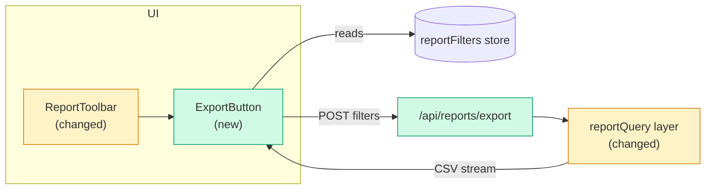
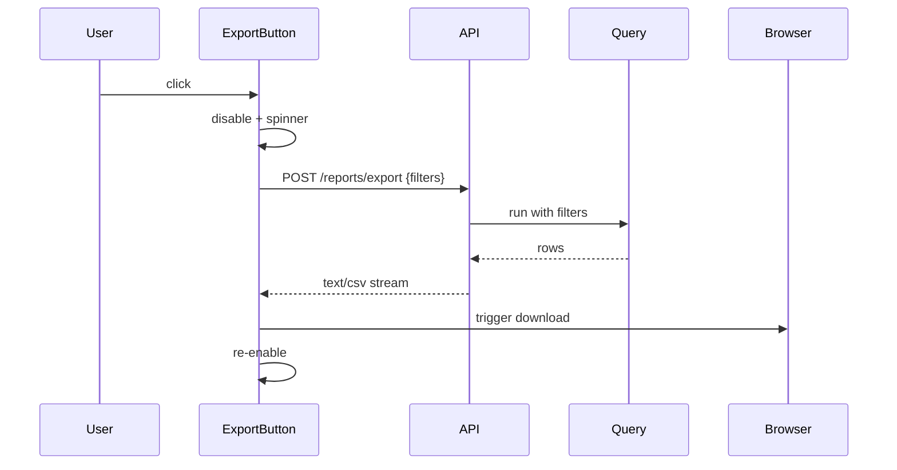

# Designing architecture

Before the plan says "add the export button", there has to be an agreed picture
of **where it sits, what it looks like, what it does, and what it talks to.**
This skill produces that picture — as diagrams plus a spec table — and gets the
user's sign-off. The plan tasks then reference it instead of re-deciding
placement and colour mid-implementation.

## Output: `.overpower/architecture.md`

Write it to `.overpower/architecture.md` (create `.overpower/` if needed). It has
these sections. Skip a section only if it genuinely doesn't apply (a pure
backend change has no Layout section; a pure UI tweak may have a trivial
Component map).

### 1. Component map — a mermaid diagram

Nodes = the components / modules / services involved. Edges = what calls or
feeds what. Mark **new** nodes and **changed** nodes distinctly from untouched
ones.



### 2. Layout — an ASCII wireframe (UI features)

Show placement, not pixels. Box-drawing, labelled. Note where the new element
goes relative to existing ones.

```
┌─ Reports ─────────────────────────────────────────────┐
│  [ All ▾ ]  [ This month ▾ ]  [ Team ▾ ]   ┌────────┐ │
│                                            │Export ⭳│ │  ← NEW: right end of the
│                                            └────────┘ │     toolbar, after filters
├───────────────────────────────────────────────────────┤
│  (results table — unchanged)                          │
└───────────────────────────────────────────────────────┘
```

### 3. Elements — the spec table

One row per element you add or change. **Where**, **Look**, **Does**, **Data**.

| Element | Where | Look | Does | Data |
|---|---|---|---|---|
| Export button | Report toolbar, right end, after the filter chips | `--color-primary` token (indigo-600), white label, download icon; 32px height to match the chips | on click → POST `/api/reports/export` with the current filter state, streams a CSV download; disabled + spinner while pending | reads `reportFilters` store |

**Colour comes from the project's tokens, not from you.** Before filling the
Look column, look for the design system: a Tailwind config, CSS custom
properties, a `theme.ts`, a component library (shadcn/MUI/Chakra). Use its token
names. If the project has none, say so and mark your colour choices
`(proposed — no design system found)` so the user knows it's your call to
confirm, not an existing standard.

### 4. States — for anything interactive

| State | Trigger | Visual |
|---|---|---|
| idle | default | enabled, label "Export CSV" |
| pending | click | disabled, spinner, label "Preparing…" |
| error | API 4xx/5xx | toast "Export failed", button re-enabled |
| empty | no rows match | button disabled, tooltip "nothing to export" |

### 5. Data flow — a mermaid sequence diagram (when a request round-trips)



### 6. Decisions

Bullet list. Each: what you chose, and the **evidence** (a constraint the user
gave, a property of the data, a measured number) — not "X is the standard".

## Then

1. Show the user the diagrams and the element table (paste the mermaid; it
   renders). Walk through each element: where, colour, behaviour.
2. Iterate on what they push back on. Re-write `architecture.md` — it's a
   design doc, not a log, so rewriting it here is fine (unlike `progress.md`).
3. Get an explicit yes.
4. Hand to `writing-plans`. Every plan task that builds a component references
   its row in `architecture.md` ("per architecture.md: Export button") so the
   implementer doesn't re-decide placement or colour.

## Optional: a clickable mockup

If the user wants to *see* it rather than read a wireframe, offer to write a
single self-contained `architecture-mockup.html` (static HTML+CSS, the real
tokens, no framework) they can open in a browser. Keep it in `.overpower/`. It's
a picture, not code to keep — the plan still builds the real thing.
